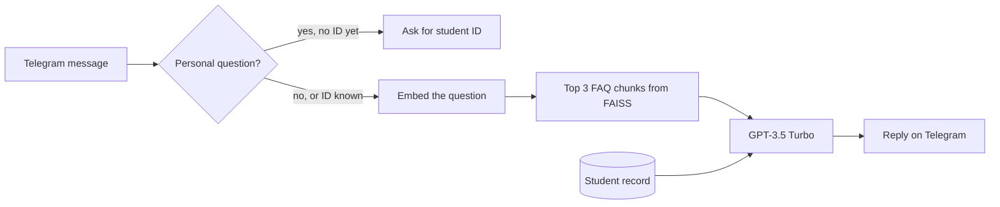

# Unisinos Chatbot

A Telegram bot that answers questions from Unisinos students, in Portuguese. General questions (how to get to the campus, enrollment documents, scholarships, the library) are answered from a FAQ document using retrieval-augmented generation. Personal questions (grades, class schedule) are answered from the student's record, looked up by student ID.

Built in 2025 as a university project. The student records are fictional.

## How it works



1. **Intent detection** (`core/intent.py`). spaCy's Portuguese model lemmatizes the message, and each lemma is checked against keyword lists for three personal topics: grades, schedule and academic history.
2. **Student ID**. If the question is personal and the chat has no student ID yet, the bot asks for it and keeps it in the conversation's `user_data`. The record is then read from `data/mock_db.py`.
3. **Retrieval** (`core/search.py`). The question is embedded with `text-embedding-ada-002` and the 3 nearest chunks are taken from a FAISS `IndexFlatL2` index.
4. **Generation** (`core/openai_client.py`). The chunks, the student record (if any) and the question go to `gpt-3.5-turbo`. The system prompt tells the model to send the student to human support when the answer is not in the context.

The knowledge base is built offline by `scripts/generate_embeddings.py`: it extracts the text of `scripts/unisinos_faq.pdf` with pdfplumber, splits it into 500-token chunks with a 100-token overlap, embeds each chunk and writes `docs.pkl` (the chunk texts) and `faiss_index.index`. Both files are committed, so the bot runs without rebuilding them.

## Project structure

```
main.py                     Entry point
bot/
  telegram_bot.py           Builds the Telegram application and registers handlers
  handlers.py               /start and message handling, student ID flow
  user_context.py           Looks up a student by ID
core/
  intent.py                 Keyword-based intent detection with spaCy
  search.py                 Similarity search on the FAISS index
  openai_client.py          Embeddings and chat completion calls
  embedding_utils.py        Token counting and chunking with tiktoken
data/
  loader.py                 Loads docs.pkl and the FAISS index
  pdf_utils.py              PDF text extraction
  mock_db.py                Fictional student records
scripts/
  generate_embeddings.py    Rebuilds the knowledge base from the FAQ PDF
  unisinos_faq.pdf          Source FAQ
```

## Running locally

You need Python 3.12 or later, an [OpenAI API key](https://platform.openai.com/api-keys) and a Telegram bot token from [@BotFather](https://t.me/BotFather).

```bash
git clone https://github.com/leonardochies/chatbot_unisinos.git
cd chatbot_unisinos
python -m venv venv
source venv/bin/activate        # Windows: venv\Scripts\activate
pip install -r requirements.txt
python -m spacy download pt_core_news_sm
cp .env.example .env            # then fill in OPENAI_API_KEY and TELEGRAM_TOKEN
python main.py
```

Run the commands from the repository root: the index files are loaded with relative paths.

To rebuild the knowledge base after changing the FAQ:

```bash
python -m scripts.generate_embeddings
```

## Trying it out

Send `/start` to the bot, then ask a general question such as "Como chego ao campus de São Leopoldo?".

For personal questions, ask something like "Quais são minhas notas?" and answer with one of the fictional student IDs: `2023001`, `2023002` or `2023003`.

## Limitations

- **Retrieval does not filter anything yet.** The FAQ produces only 3 chunks and the search always returns 3, so every question is sent with the whole FAQ. There is also no similarity threshold, so unrelated questions still get the closest chunks.
- **Intent detection misses common phrasings.** The keyword lists contain plural forms and two-word phrases, but they are compared against single-word lemmas. "Quais são minhas notas?" is detected; "Quais são minhas aulas?", "Quais disciplinas estou cursando?" and "Quais cadeiras eu reprovei?" are not.
- **No authentication.** Anyone who types a valid student ID sees that student's grades. A real deployment would need the university's login.
- **Blocking API calls.** The OpenAI client is synchronous inside async handlers, so the bot waits on each request before serving the next user.
- **Raw errors reach the user.** Exceptions are sent to the chat as they are.
- **PDF extraction loses accents** in some words, which lowers the quality of the embeddings.
- **No automated tests.**

## What I would change today

- Split the FAQ by question and answer instead of by token count, keep it as Markdown instead of a PDF, and drop results below a similarity threshold.
- Fix the intent keywords to use singular lemmas, or let the model classify the intent.
- Measure accuracy with a fixed set of questions with known answers before and after each change.
- Add pytest tests for intent detection, the student lookup and chunking, with the OpenAI calls mocked.
- Switch to `AsyncOpenAI`, log errors instead of showing them, and move to current OpenAI models.

## License

GPL-3.0. See [LICENSE](LICENSE).
